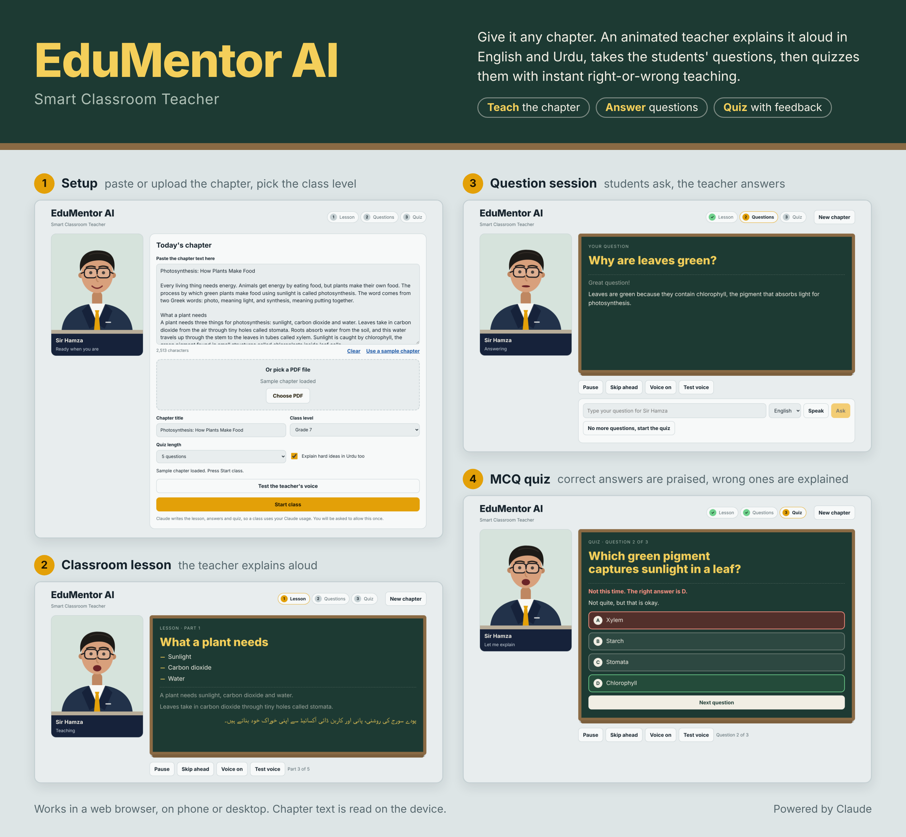

# EduMentor AI – Smart Classroom Teacher

EduMentor AI is an AI teacher for the classroom. Give it a chapter and an animated teacher teaches it aloud in English and Urdu, takes the students' questions, then quizzes them with instant right-or-wrong explanations.

Demo video: [EduMentor-AI-demo.mp4](EduMentor-AI-demo.mp4) (76 seconds, one full class)

## How a class runs

1. **Lesson.** The teacher, Sir Hamza, greets the students, introduces the chapter and teaches it part by part. Key points and every spoken sentence appear on a chalkboard. Hard ideas get a short Urdu explanation.
2. **Questions.** Students type or speak a question. The teacher answers on the board and aloud.
3. **Quiz.** The AI writes multiple-choice questions from the chapter and reads them out. Correct answers are praised. Wrong answers get the right option and a teaching explanation. A score comes at the end.

## Features

- Chapter input by PDF upload or pasted text
- Animated teacher avatar that talks while speaking
- Spoken lesson (browser speech synthesis), English and Urdu mix, with an Urdu on/off option
- Typed or voice questions
- Class level and quiz length settings
- Pause, skip ahead and voice on/off controls
- Works in a web browser on phone or desktop

## Built with

HTML, CSS and JavaScript in a single file (`index.html`), pdf.js for reading PDFs, the browser's speech synthesis for the teacher's voice, and Claude for writing the lesson, answers and quiz.

## Running it

The lesson, answers and quiz are written by Claude through the Claude artifact runtime (`window.claude`). Open the page inside a Claude artifact to run a full class. Opened elsewhere (for example GitHub Pages), the interface loads but it cannot start a class, because that runtime is not present.

## Files

- `index.html` – the whole app
- `EduMentor-AI-overview.png` – setup, lesson, question session and quiz screens
- `EduMentor-AI-demo.mp4` – short walkthrough video
